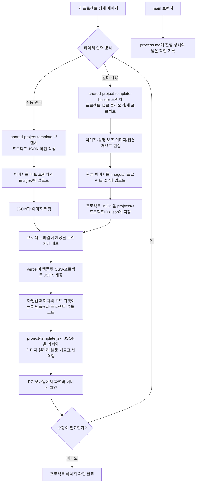
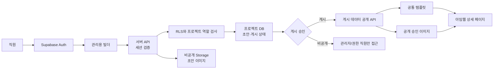

# 프로젝트 상세 공통 템플릿 진행 기록

최종 업데이트: 2026-10-26

## 목표

프로젝트 상세 페이지의 화면 구조와 스타일은 공통 템플릿으로 관리하고, 프로젝트별 이미지·설명·캡션·개요표는 별도 JSON 데이터로 분리합니다. 새 상세 페이지를 만들 때 템플릿을 복사하지 않고 프로젝트 ID로 데이터를 불러오도록 구성합니다.

## 완료 및 확인된 내용

- Tempin 공통 템플릿 MVP를 만들었습니다. 화면은 `project-template.js`와 `project-template.css`, 프로젝트 콘텐츠는 `projects/<id>.json`에서 관리합니다.
- 메뉴 패널 배경은 투명하게 유지하도록 수정했습니다.
- 아임웹 코드 위젯에서 공통 템플릿을 불러오는 방식을 확인했습니다.
- `yaein-church-interior` 프로젝트의 JSON과 이미지들을 `vercel-deploy`에 추가했습니다. JSON 문법 오류를 수정한 뒤 사용자가 아임웹에서 페이지가 작동하는 것을 확인했습니다.
- 프로젝트 JSON이 이전 내용으로 보일 수 있는 캐시 문제를 줄이도록 데이터 요청에 `cache: "no-store"`와 시간 기반 쿼리를 적용했습니다. `/projects/*` 및 템플릿 JS/CSS 응답에도 캐시 방지 헤더를 추가했습니다.
- 기존 이미지 업로드 빌더와는 별개로 공통 템플릿을 사용하는 두 가지 브랜치를 준비했습니다.

## 브랜치별 구성

### `vercel-deploy`

공통 템플릿과 Tempin 및 예인교회 프로젝트 데이터가 있는 테스트 배포 브랜치입니다. 캐시 방지 수정은 `c5031fd`에 반영했습니다. 운영 `main`에는 공통 템플릿을 배포하지 않았습니다.

예인교회 데이터:

```text
projects/yaein-church-interior.json
```

테스트 JSON: <https://filtwebsite-verceltest.vercel.app/projects/yaein-church-interior.json>

### `shared-project-template`

공통 템플릿과 프로젝트별 데이터를 수동으로 관리하는 버전입니다. 새 프로젝트 JSON을 직접 만들고 이미지는 배포 브랜치의 `images/`에 저장합니다. 사용 방법은 해당 브랜치의 `README.md`를 참고합니다.

### `shared-project-template-builder`

공통 템플릿 데이터까지 편집할 수 있도록 기존 빌더를 연결한 별도 버전입니다.

- 프로젝트 ID로 기존 프로젝트를 불러오거나 빈 프로젝트를 시작합니다.
- 갤러리 이미지, 설명, 보조 이미지/캡션, 개요표를 편집합니다.
- 원본 이미지를 `images/<프로젝트ID>/`에 업로드하고, 프로젝트 데이터를 `projects/<프로젝트ID>.json`으로 저장하도록 구성했습니다.
- API와 편집기 코드 검사 및 GitHub API 모의 테스트를 통과했습니다.
- 실제 Vercel Preview 환경변수 구성 및 브라우저에서의 빌더 저장 동작은 아직 확인되지 않았습니다.

각 브랜치 작업은 GitHub에 푸시했으며, 브랜치별 커밋은 저장소 기록에서 확인할 수 있습니다.

## Workflow 다이어그램



**현재 확인 상태:** 예인교회 페이지는 아임웹에서 작동하는 것을 확인했습니다. 빌더 포함 브랜치의 실제 Vercel Preview 저장 흐름, PC/모바일 전수 점검, 운영 도메인 연결은 아직 확인 또는 결정이 남아 있습니다.

## 아임웹 연결 방법

현재 테스트 배포 주소를 사용하는 코드입니다. `data-filt-project`와 `data-project-id` 값은 JSON 파일명 및 `id`와 일치해야 합니다.

```html
<div class="filt-project-mount" data-filt-project="yaein-church-interior"></div>
<script src="https://filtwebsite-verceltest.vercel.app/project-template.js" data-project-id="yaein-church-interior"></script>
```

이미지는 GitHub 파일 보기 주소(`/blob/...`)가 아니라 공개 이미지 URL을 사용합니다. `vercel-deploy`에 `images/261001 필트 수원 예인교회 셀렉용-42.jpg`로 저장된 예시:

```text
https://raw.githubusercontent.com/filtehwa/filt_website/vercel-deploy/images/261001%20%ED%95%84%ED%8A%B8%20%EC%88%98%EC%9B%90%20%EC%98%88%EC%9D%B8%EA%B5%90%ED%9A%8C%20%EC%85%80%EB%A0%89%EC%9A%A9-42.jpg
```

## 남은 작업

1. `shared-project-template-builder` 브랜치를 Vercel Preview에 연결하고 필요한 인증 및 GitHub 쓰기 환경변수가 Preview 환경에도 설정됐는지 확인합니다.
2. 빌더 Preview에서 새 프로젝트 생성, 원본 이미지 업로드, JSON 저장/재불러오기, 보조 이미지와 개요표 편집을 실제 브라우저로 확인합니다.
3. 예인교회 페이지를 아임웹 PC 및 모바일에서 확인하고, 이미지 크롭/여백과 메뉴 투명도를 최종 점검합니다. 사용자는 페이지가 작동하는 것을 확인했지만, 모든 화면 크기와 이미지 레이아웃 검수는 별도 확인이 남아 있습니다.
4. 테스트가 끝난 뒤 공통 템플릿을 실제 사용할 배포 브랜치/도메인으로 옮기고, 아임웹 코드 위젯의 테스트 호스트를 최종 호스트로 교체할지 결정합니다. 현재까지 운영 `main` 사이트는 변경하지 않았습니다.
5. 여러 프로젝트에서 WORKS LIST로 이어지는 경로와 새 프로젝트 등록 절차를 실제 사이트 구성에 맞춰 확인합니다.

## Supabase 확장 계획

### 지금 당장 연결할 필요가 있는가?

현재처럼 프로젝트 JSON과 이미지를 GitHub/Vercel에서 제공하고, 소수의 관리자만 빌더를 사용하는 MVP에는 Supabase가 필수는 아닙니다. 다만 여러 직원에게 편집 계정을 발급하고 역할별 권한, 프로젝트별 접근 제한, 초안/게시 상태를 운영하려면 Supabase Auth와 Postgres를 관리용 빌더의 백엔드로 검토합니다.

Supabase를 도입해도 공통 템플릿 자체가 없어지는 것은 아닙니다. 템플릿은 화면 렌더러로 유지하고, 프로젝트 콘텐츠를 읽고 저장하는 경로를 정적 JSON/GitHub에서 권한을 확인하는 API와 데이터베이스로 전환합니다. 공개 Imweb 상세 페이지는 게시된 프로젝트만 공개 API에서 읽도록 하고, 초안 및 비공개 원본은 브라우저에 공개된 정적 JSON이나 공개 Storage URL에 두지 않습니다.

### 권장 구성

- **직원 로그인:** Supabase Auth로 직원별 계정을 발급하고, 퇴사/권한 회수 시 계정을 비활성화합니다. 서비스용 `service_role` 키는 서버 환경변수에만 두며 브라우저 코드에 포함하지 않습니다.
- **역할과 프로젝트 접근:** `profiles`에 전역 역할(`admin`, `editor`, `viewer`)을 두고, `project_members`에 직원별 프로젝트 접근 관계를 둡니다. 관리자만 직원을 초대하고 역할을 변경하도록 제한합니다.
- **프로젝트 데이터:** `projects`에는 ID, 제목, 본문/구조화된 콘텐츠, 상태(`draft`, `published`, `archived`), 작성/수정자 및 시간을 저장합니다. 기존 `images`, `descriptionHtml`, `overview.fields` 콘텐츠는 마이그레이션 초기에는 JSONB 한 열에 보존할 수 있고, 검색/항목별 편집 요구가 커지면 이미지와 개요 항목을 별도 테이블로 분리합니다.
- **권한 강제:** 모든 테이블에 RLS(Row Level Security)를 활성화합니다. 편집 화면에서 버튼을 숨기는 것만으로 권한을 처리하지 않습니다. 데이터베이스 정책/API가 사용자 역할과 프로젝트 멤버십을 매 요청마다 검증하게 합니다.
- **게시와 공개:** 편집자는 권한이 있는 프로젝트의 초안을 수정하고, 게시 권한을 가진 사용자만 공개 상태로 전환합니다. 공개 페이지에는 `published` 프로젝트만 읽히도록 하고, 미리보기는 로그인한 직원에게만 제한된 만료 URL 또는 인증 API로 제공합니다.
- **이미지:** 비공개 원본/초안 이미지는 비공개 Storage 버킷에 저장하고, 인증된 사용자에게만 서명 URL을 발급합니다. 게시된 웹페이지에서 필요한 이미지만 공개 경로로 게시하거나 공개용 전달 API를 둡니다. 공개 게시 이미지에 한해서만 공개 URL을 사용합니다.
- **감사/복구:** 마지막 수정자와 수정 시각을 기록하고, 중요한 게시 전에는 버전 스냅샷 또는 백업을 남깁니다. 기존 Git 커밋 기록은 마이그레이션 기간 동안 원본 복구 자료로 보존합니다.

### 단계별 전환

1. **요구사항 확정:** 직원 수, 역할, 프로젝트별 읽기/수정 범위, 승인/게시 담당자, 초안 공개 여부를 정합니다. 역할 모델은 실제 업무 규칙에 맞춰 확정합니다.
2. **무료 시험 환경:** 별도 Supabase 개발 프로젝트에서 Auth, 최소 테이블, RLS 정책을 만들고 더미 프로젝트로 권한 테스트를 합니다. 운영 데이터와 키를 개발 환경에 복사하지 않습니다.
3. **권한 테스트:** 비로그인, viewer, editor, admin 각각으로 읽기/쓰기/게시 요청을 검증합니다. 다른 프로젝트 ID를 직접 지정해도 접근이 차단되는지 API와 RLS 양쪽에서 확인합니다.
4. **빌더 연결:** 기존 편집 화면을 유지하면서 저장/불러오기를 서버 API로 바꿉니다. API가 사용자 세션을 검증한 뒤에만 데이터베이스와 Storage를 사용하도록 합니다.
5. **기존 데이터 가져오기:** GitHub의 각 `projects/<id>.json`을 읽어 프로젝트 ID를 유지한 채 `draft` 상태로 가져옵니다. 이미지 URL을 검사하고, 누락/중복/권한을 확인한 뒤 관리자가 샘플 프로젝트를 검수합니다.
6. **비공개 파일 이전:** 필요할 때 GitHub 공개 URL의 원본과 초안 이미지를 비공개 Storage로 옮깁니다. 게시 여부를 확인하기 전까지 기존 공개 URL을 제거하거나 기존 페이지를 변경하지 않습니다.
7. **점진적 전환:** 내부 사용자와 테스트 프로젝트부터 사용하고, 문제 시 기존 GitHub JSON/배포 버전으로 되돌릴 수 있도록 일정 기간 읽기 전용 백업 및 롤백 절차를 유지합니다.
8. **운영 적용:** 권한·백업·복구 및 Imweb 공개 페이지 렌더링을 검증한 뒤에만 운영 도메인의 데이터 조회를 새 공개 API로 전환합니다.



### 비용 가이드

2026-10-26 확인한 Supabase 공식 요금표 기준의 대략적인 시작점입니다. 실제 결제 시에는 최신 요금 및 환율/세금을 다시 확인합니다.

- **Free:** 월 $0. 시제품/개발용으로 시작할 수 있지만, Free 프로젝트는 1주 비활성 후 일시 중지될 수 있고 활성 프로젝트 수 및 DB/Storage/전송량 제한이 있습니다. 상시 운영의 가용성을 보장하는 구성으로 간주하지 않습니다.
- **Pro:** 조직 기본료 월 $25부터입니다. 포함된 $10 컴퓨트 크레딧은 Micro 인스턴스 한 개 비용을 상쇄하므로, 일반적인 단일 Micro 프로젝트는 현재 요금표에서 총 월 $25부터 시작합니다. 포함량 초과 DB, Storage, egress 및 추가 프로젝트 컴퓨트는 별도 비용이 될 수 있습니다.
- **직원 로그인:** Auth 비용은 월간 활성 사용자(MAU) 기준의 무료 포함량이 있어 소규모 사내 사용자만으로는 대개 기본료 외 추가 요금이 없을 수 있지만, 실제 활성 사용자 수와 인증 방식에 따라 확인해야 합니다.
- **주의:** Supabase는 데이터베이스/인증/파일 저장 서비스 비용입니다. 개발·유지보수 작업 비용, 도메인, 메일 발송 서비스 등은 별도일 수 있습니다. Team 플랜은 조직 차원의 SSO나 관리 기능이 실제로 필요해질 때 검토하고, 일반 직원 앱 계정 발급만으로 바로 필요하다고 가정하지 않습니다.

참고: [Supabase 요금표](https://supabase.com/pricing), [Supabase 결제 안내](https://supabase.com/docs/guides/platform/billing-on-supabase)

## 주의 사항

- `vercel-deploy`의 테스트 페이지/데이터 수정은 그 브랜치를 제공하는 테스트 배포에만 반영됩니다. `main`에 자동으로 반영되지 않습니다.
- JSON을 수동 편집할 때 문자열과 객체 사이 쉼표를 확인하고, 커밋 전에 JSON 파싱 검사를 합니다.
- 이미지 파일이 들어 있는 브랜치와 이미지 URL의 브랜치 경로가 일치해야 합니다.
- 본 문서는 진행 현황 기록이며, 운영 반영이나 모바일/브라우저 전체 검수가 완료됐다는 뜻은 아닙니다.
- Supabase 설계는 향후 확장 제안이며, 아직 프로젝트에 연결하거나 직원 계정을 만든 상태가 아닙니다.
