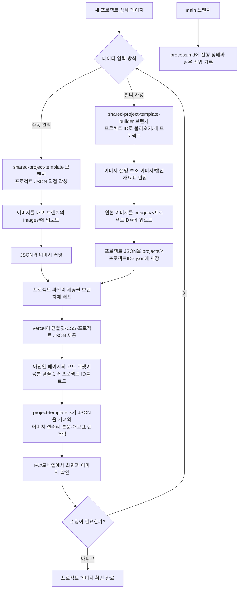

# 프로젝트 상세 공통 템플릿 진행 기록

최종 업데이트: 2026-10-26

## 목표

프로젝트 상세 페이지의 화면 구조와 스타일은 공통 템플릿으로 관리하고, 프로젝트별 이미지·설명·캡션·개요표는 별도 JSON 데이터로 분리합니다. 새 상세 페이지를 만들 때 템플릿을 복사하지 않고 프로젝트 ID로 데이터를 불러오도록 구성합니다.

## 완료 및 확인된 내용

- Tempin 공통 템플릿 MVP를 만들었습니다. 화면은 `project-template.js`와 `project-template.css`, 프로젝트 콘텐츠는 `projects/<id>.json`에서 관리합니다.
- 메뉴 패널 배경은 투명하게 유지하도록 수정했습니다.
- 아임웹 코드 위젯에서 공통 템플릿을 불러오는 방식을 확인했습니다.
- `yaein-church-interior` 프로젝트의 JSON과 이미지들을 `vercel-deploy`에 추가했습니다. JSON 문법 오류를 수정한 뒤 사용자가 아임웹에서 페이지가 작동하는 것을 확인했습니다.
- 프로젝트 JSON이 이전 내용으로 보일 수 있는 캐시 문제를 줄이도록 데이터 요청에 `cache: "no-store"`와 시간 기반 쿼리를 적용했습니다. `/projects/*` 및 템플릿 JS/CSS 응답에도 캐시 방지 헤더를 추가했습니다.
- 기존 이미지 업로드 빌더와는 별개로 공통 템플릿을 사용하는 두 가지 브랜치를 준비했습니다.

## 브랜치별 구성

### `vercel-deploy`

공통 템플릿과 Tempin 및 예인교회 프로젝트 데이터가 있는 테스트 배포 브랜치입니다. 캐시 방지 수정은 `c5031fd`에 반영했습니다. 운영 `main`에는 공통 템플릿을 배포하지 않았습니다.

예인교회 데이터:

```text
projects/yaein-church-interior.json
```

테스트 JSON: <https://filtwebsite-verceltest.vercel.app/projects/yaein-church-interior.json>

### `shared-project-template`

공통 템플릿과 프로젝트별 데이터를 수동으로 관리하는 버전입니다. 새 프로젝트 JSON을 직접 만들고 이미지는 배포 브랜치의 `images/`에 저장합니다. 사용 방법은 해당 브랜치의 `README.md`를 참고합니다.

### `shared-project-template-builder`

공통 템플릿 데이터까지 편집할 수 있도록 기존 빌더를 연결한 별도 버전입니다.

- 프로젝트 ID로 기존 프로젝트를 불러오거나 빈 프로젝트를 시작합니다.
- 갤러리 이미지, 설명, 보조 이미지/캡션, 개요표를 편집합니다.
- 원본 이미지를 `images/<프로젝트ID>/`에 업로드하고, 프로젝트 데이터를 `projects/<프로젝트ID>.json`으로 저장하도록 구성했습니다.
- API와 편집기 코드 검사 및 GitHub API 모의 테스트를 통과했습니다.
- 실제 Vercel Preview 환경변수 구성 및 브라우저에서의 빌더 저장 동작은 아직 확인되지 않았습니다.

각 브랜치 작업은 GitHub에 푸시했으며, 브랜치별 커밋은 저장소 기록에서 확인할 수 있습니다.

## Workflow 다이어그램



**현재 확인 상태:** 예인교회 페이지는 아임웹에서 작동하는 것을 확인했습니다. 빌더 포함 브랜치의 실제 Vercel Preview 저장 흐름, PC/모바일 전수 점검, 운영 도메인 연결은 아직 확인 또는 결정이 남아 있습니다.

## 아임웹 연결 방법

현재 테스트 배포 주소를 사용하는 코드입니다. `data-filt-project`와 `data-project-id` 값은 JSON 파일명 및 `id`와 일치해야 합니다.

```html
<div class="filt-project-mount" data-filt-project="yaein-church-interior"></div>
<script src="https://filtwebsite-verceltest.vercel.app/project-template.js" data-project-id="yaein-church-interior"></script>
```

이미지는 GitHub 파일 보기 주소(`/blob/...`)가 아니라 공개 이미지 URL을 사용합니다. `vercel-deploy`에 `images/261001 필트 수원 예인교회 셀렉용-42.jpg`로 저장된 예시:

```text
https://raw.githubusercontent.com/filtehwa/filt_website/vercel-deploy/images/261001%20%ED%95%84%ED%8A%B8%20%EC%88%98%EC%9B%90%20%EC%98%88%EC%9D%B8%EA%B5%90%ED%9A%8C%20%EC%85%80%EB%A0%89%EC%9A%A9-42.jpg
```

## 남은 작업

1. `shared-project-template-builder` 브랜치를 Vercel Preview에 연결하고 필요한 인증 및 GitHub 쓰기 환경변수가 Preview 환경에도 설정됐는지 확인합니다.
2. 빌더 Preview에서 새 프로젝트 생성, 원본 이미지 업로드, JSON 저장/재불러오기, 보조 이미지와 개요표 편집을 실제 브라우저로 확인합니다.
3. 예인교회 페이지를 아임웹 PC 및 모바일에서 확인하고, 이미지 크롭/여백과 메뉴 투명도를 최종 점검합니다. 사용자는 페이지가 작동하는 것을 확인했지만, 모든 화면 크기와 이미지 레이아웃 검수는 별도 확인이 남아 있습니다.
4. 테스트가 끝난 뒤 공통 템플릿을 실제 사용할 배포 브랜치/도메인으로 옮기고, 아임웹 코드 위젯의 테스트 호스트를 최종 호스트로 교체할지 결정합니다. 현재까지 운영 `main` 사이트는 변경하지 않았습니다.
5. 여러 프로젝트에서 WORKS LIST로 이어지는 경로와 새 프로젝트 등록 절차를 실제 사이트 구성에 맞춰 확인합니다.

## 주의 사항

- `vercel-deploy`의 테스트 페이지/데이터 수정은 그 브랜치를 제공하는 테스트 배포에만 반영됩니다. `main`에 자동으로 반영되지 않습니다.
- JSON을 수동 편집할 때 문자열과 객체 사이 쉼표를 확인하고, 커밋 전에 JSON 파싱 검사를 합니다.
- 이미지 파일이 들어 있는 브랜치와 이미지 URL의 브랜치 경로가 일치해야 합니다.
- 본 문서는 진행 현황 기록이며, 운영 반영이나 모바일/브라우저 전체 검수가 완료됐다는 뜻은 아닙니다.
